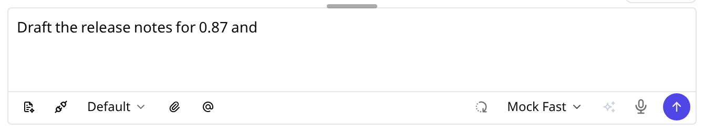
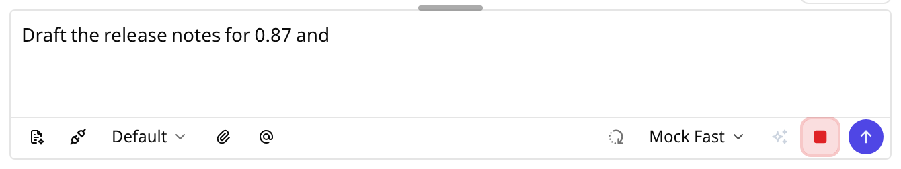
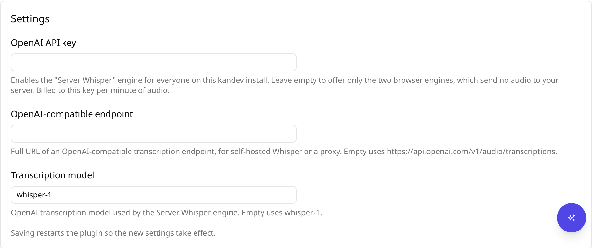
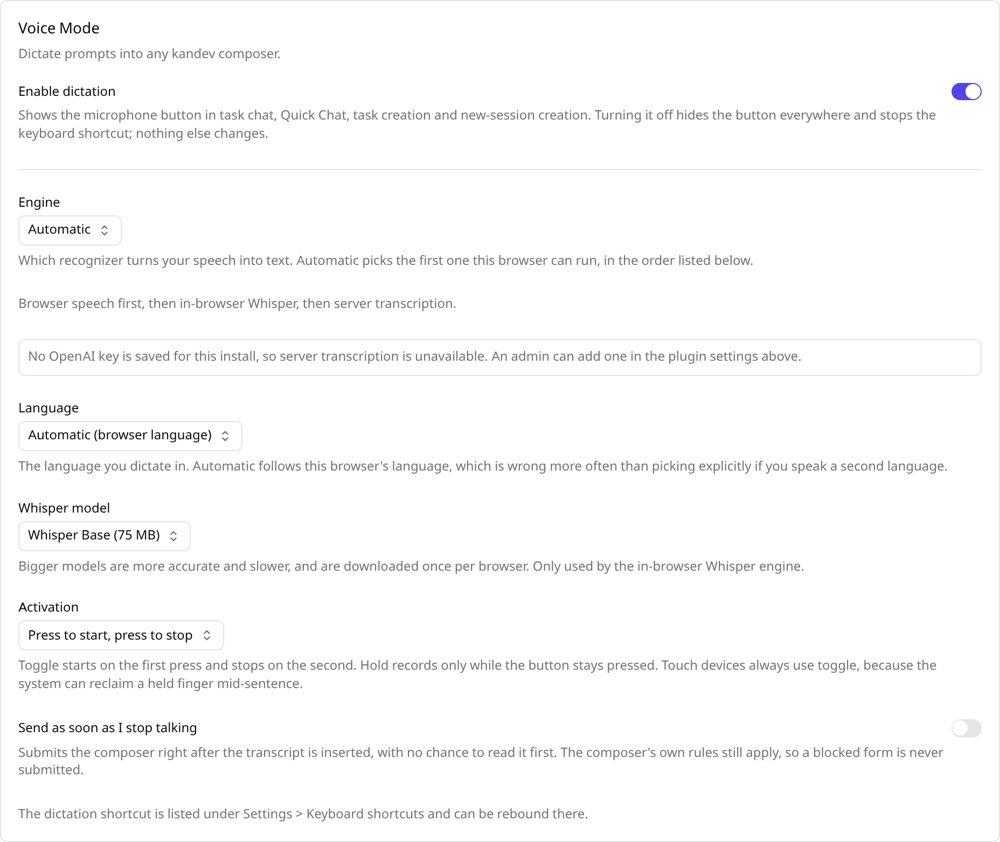
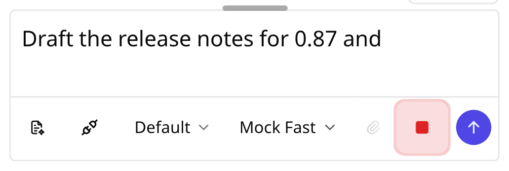

# kandev-plugin-voice

Voice Mode for [kandev](https://github.com/kdlbs/kandev): dictate a prompt into
any native composer instead of typing it.

The microphone button appears beside the existing composer controls in task
chat, Quick Chat, task creation and new-session creation, on desktop and on a
phone. On Kandev v0.97.0, the Quick Chat setup composer also exposes the plugin
action: dictate the opening prompt there, then start the session. Speak, and
the transcript is inserted at your cursor. kandev keeps ownership of the draft
and of submission throughout — the plugin never builds or sends a message
itself.



Press it and it records; press again and the transcript lands at the caret.



This plugin was extracted from kandev core, which shipped Voice Mode until the
composer capability and authenticated-webhook host APIs made a standalone
plugin possible.

## Engines

Three recognizers, picked automatically or chosen per user in
**Settings → Plugins → Voice Mode**:

| Engine               | Where the audio goes                          | Trade-off                                                                                  |
| -------------------- | --------------------------------------------- | ------------------------------------------------------------------------------------------ |
| Browser speech       | The browser vendor's servers                  | Fastest, free, no download. Chromium only.                                                 |
| In-browser Whisper   | Nowhere: it stays on the device               | Fully private. Downloads a 40–240 MB model once, then a few seconds per recording.         |
| Server transcription | Your kandev server, which relays it to OpenAI | Most accurate, works in every browser. Needs an operator API key and is billed per minute. |

`Automatic` picks the first of those the browser can run, in that order. A
pinned engine that turns out to be unusable degrades the same way rather than
leaving a dead button.

## Setup

1. Install the plugin (Settings → Plugins → Install, or the tarball upload
   below). Source builds using public SDK **0.1.0** require kandev **v0.99.0**
   or newer, as declared by both SDK release records. Keep the leading `v` in
   the manifest so older installers also reject this archive safely.
2. Optional: paste an **OpenAI API key** into the plugin's settings form to
   enable the server engine for everyone on the install. Without it, the two
   browser engines still work and no audio ever reaches your server.
3. Each user picks their engine, language, activation style and auto-send under
   Settings → Plugins → Voice Mode. Those preferences are per-user, not shared.

The key is an operator setting, rendered by kandev from the manifest's
`config_schema` and stored in its encrypted vault. It never reaches the browser:
the plugin's Go half relays the audio server-side.



Everything below that is per-user, and every control explains what it changes
and what it costs:



The dictation shortcut defaults to `Cmd/Ctrl+Shift+M` and is rebindable under
Settings → Keyboard shortcuts like any other kandev shortcut. It is one of the
few plugin bindings that fires while a composer has focus (manifest
`allow_in_editor`), because dictating into the field you are typing in is the
entire point.

### On a phone

The action stays beside the composer. On hosts with the Action API it uses the
host's touch target; the legacy fallback follows the host's existing button
geometry. Hold-to-talk becomes press-to-toggle on phones and coarse pointers.
The saved setting stays unchanged, so a docked keyboard restores hold-to-talk.



## Privacy and cost

- **Browser speech** streams audio to the browser vendor. Chromium sends it to
  Google.
- **In-browser Whisper** downloads model weights from the Hugging Face CDN on
  first use and then runs entirely offline. No audio leaves the device.
- **Server transcription** uploads the recording to this plugin's authenticated
  `transcribe` webhook, which relays it to OpenAI with the operator's key and
  returns only the text. The key never reaches the browser, the webhook rejects
  anonymous callers, and an upstream error is never echoed back to the page.
- Nothing is stored. The plugin keeps no recordings, no transcripts and no
  history; its only persisted data is your per-user preferences.

## Repository layout

```text
kandev-plugin-voice/
├── manifest.yaml         # id, capabilities, webhook, keybinding, config schema
├── server/               # Go: the transcribe webhook and the OpenAI relay
└── ui/
    ├── src/              # TypeScript: engines, composer action, settings page
    ├── build.mjs         # esbuild: bundle.js + whisper-worker.js
    └── plugin.css        # plugin-owned styling (see the note below)
```

The UI ships its own CSS rather than using kandev's Tailwind utilities:
Tailwind v4 only compiles classes it finds while scanning kandev's own sources,
so a utility that works today would break the moment kandev deletes its last
use of it.

## Development

Use Node 24, pnpm 10.34.5 and Go 1.26. The backend uses the public module
`github.com/kdlbs/kandev/pluginsdk v0.1.0`; frontend SDK types use
`@kdlbs/plugin-sdk` exactly `0.1.0`. Compilation, typechecking and unit tests
work in a standalone checkout without Kandev sources.

```bash
corepack prepare pnpm@10.34.5 --activate
make ui-install
make sdk-check
make check-format
make vet
make test
make typecheck
make build
```

`make sdk-check` runs the public compatibility checker from the frontend
project, where its pnpm lockfile and installed dependencies live:

```bash
cd ui
go run github.com/kdlbs/kandev/pluginsdk/cmd/kandev-sdk-check@v0.1.0 \
  --manifest ../manifest.yaml --frontend-sdk node_modules/@kdlbs/plugin-sdk
```

Go and npm share an independent SDK version; it is separate from the plugin
version and host release. For deliberate SDK upgrades, update both exact pins,
regenerate `go.sum` and `ui/pnpm-lock.yaml`, inspect both installed
`sdk-release.json` records, and use at least the highest SDK-wide
`min_kandev_version`. Preserve a supported manifest `api_version`. Rerun the
checker, tests, packaging and minimum-host smoke before committing the upgrade.

`make test` runs the actual Go and UI tests, package-verifier and release-floor
tests, and imports the built UI bundle into a disposable host fixture with fake
speech recognition. `make typecheck` checks frontend types. There are no recipe
subprojects in this repository.

### Packaging tools

Packaging still requires backend-owned `plugin-pack`. This is a separate input
from the public SDK dependencies. `.kandev-tooling-ref` pins its tested source
commit; include the root `pluginsdk/` directory because the backend module uses
it locally. A packaging checkout does not supply this plugin's SDK types.

```bash
git clone --filter=blob:none --no-checkout https://github.com/kdlbs/kandev.git /tmp/voice-kandev-tools
git -C /tmp/voice-kandev-tools sparse-checkout set apps/backend pluginsdk
git -C /tmp/voice-kandev-tools checkout "$(cat .kandev-tooling-ref)"
make verify-package-host KANDEV_TOOLING=/tmp/voice-kandev-tools/apps/backend
make verify-package KANDEV_TOOLING=/tmp/voice-kandev-tools/apps/backend
```

These targets run the compatibility checker before building, stage only the
manifest, binaries and three UI assets, and verify exact archive contents and
generated checksums. CI compilation/typechecking has no Kandev checkout;
packaging/release jobs explicitly check out only the pinned tooling sources.

### Real-host browser smoke

Use a disposable Kandev **v0.99.0** runtime and matching source commit
`f0e2e774cfe2df8a0d15e4c21dea7b48580e38fb`. The browser suite installs the
archive and checks task chat, Quick Chat, task creation and new-session controls
on desktop and Pixel 5. It covers pointer capture, focused shortcuts, busy and
permission states, microphone cancellation and re-enable cleanup. Browser
speech, microphone and Whisper worker APIs are fake; no provider credentials
or personal audio are needed.

```bash
# In a separate checkout of the exact minimum-host release:
(cd "$KANDEV_HOST_ROOT/apps" && corepack pnpm@9.15.9 install --frozen-lockfile)
(cd "$KANDEV_HOST_ROOT/apps/web" && corepack pnpm@9.15.9 run build:e2e)
make -C "$KANDEV_HOST_ROOT/apps/backend" build-mock-agent build-e2e-delivery-fixture build-e2e-send-now-fixture e2e-plugin-ui e2e-plugin-package
(cd "$KANDEV_HOST_ROOT/apps/web" && corepack pnpm@9.15.9 exec playwright install chromium)

# Extract the official v0.99.0 Linux x64 archive into a disposable directory.
export KANDEV_E2E_BIN=/path/to/disposable/runtime/bin/kandev
export VOICE_TMPDIR="$(mktemp -d /tmp/voice-v099.XXXXXX)"
export VOICE_PACKAGE_PATH="$PWD/$(make -s package-file)"
export VOICE_EXPECT_HOST_VERSION=v0.99.0
VOICE_HOST_VARIANT=modern ui/e2e/run-host-smoke.sh
```

Set `KANDEV_HOST_ROOT` to the matching release-source checkout. The runner
stages its mock-agent fixture beside the disposable runtime, and verifies the
runtime version through `/health`. Keep `VOICE_TMPDIR` outside
`~/.kandev/tasks`, which the host excludes from task repositories. The retained
legacy and below-minimum fixtures are diagnostic paths; the migrated package
requires v0.99.0 and must not be installed on the former v0.88.0 minimum.

Exact migration validation commands and results are recorded in
[docs/sdk-migration-validation.md](docs/sdk-migration-validation.md).

## Package and release

Use `make verify-package-host` for a local host archive. Use `make
verify-package` for the full platform archive. Both commands build the UI and
check the exact package contents and checksums.

Install an archive into a **disposable** Kandev instance:

```bash
curl -F package=@kandev-plugin-voice-0.2.0.tar.gz \
  http://localhost:8080/api/plugins/install
```

Kandev rejects a second install with the same plugin ID and version. Uninstall
the plugin before you reinstall that package.

To publish a release, run the `release` workflow from `main`. Select a version
bump and keep `dry_run` false. The workflow checks the UI, Go backend and full
package before it commits release metadata and a version tag.

The workflow also accepts a pushed `vMAJOR.MINOR.PATCH` tag. It checks that the
tag, manifest, Makefile and package versions match before it creates a release.

## Troubleshooting

If the browser cannot access the microphone, open Kandev over HTTPS or use
`http://localhost`. Browsers do not allow microphone access from an insecure
page.

If Server Whisper is unavailable, ask a Kandev operator to set the OpenAI API
key in the plugin's operator settings. The browser engines do not need this key.

## License

MIT. See [LICENSE](LICENSE).
